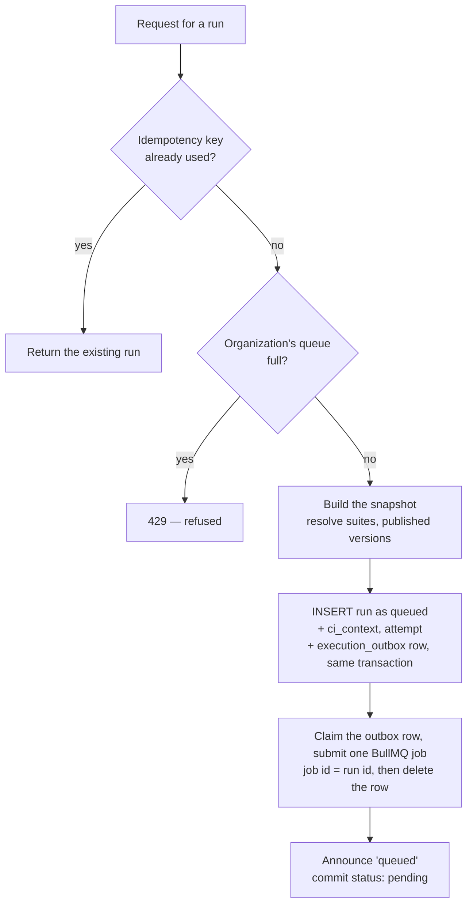
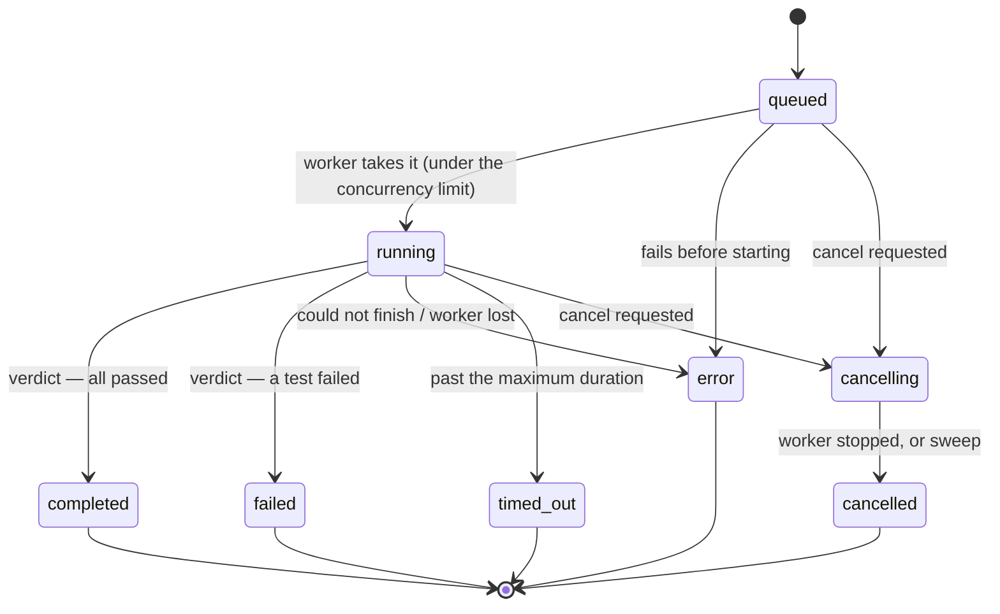

# Run lifecycle

A **run** (a row of `test_plan_executions`) is one execution of a test plan. This page follows a run
from the moment somebody asks for it to the commit status that reports it, and explains the
mechanisms that keep it correct when processes crash, requests repeat and workers race.

## Who asks for a run

New runs freeze UI/API definitions and their exact versions at enqueue alongside mobile, datasets
and plan settings. Publication is resolved there. Changing a published version during the wait
does not change the queued run. Current mandatory review can skip a frozen working copy.

Snapshots are private runner data: execution list/detail, run-start and cancellation JSON APIs
omit them and expose safe provenance. SHA-256 covers canonical JSON (sorted keys, ordered arrays)
for settings, definitions and datasets. Replay lineage is excluded from the input fingerprint.
Workers reject incomplete or mismatching new snapshots. Deleted tests can still produce results:
their original IDs stay in provenance while missing relational foreign keys are null.

`POST /api/test-plan-executions/:executionId/replay` accepts only `{ "mode": "historical" }`.
It verifies source visibility/integrity, copies the configuration without expanding today's plan,
checks current quotas and queues a new manual run. `replayOf` identifies the source; schedule and
CI status are not inherited. `Idempotency-Key` is scoped to the source. Incomplete/legacy inputs:
`409`; inaccessible source or missing plan: `404`. The plan must still exist. No migration/backfill
claims completeness for legacy runs, which keep their prior worker-time resolution.

Environment variables/secrets, saved sessions, grids, agents, browser binaries, BDD profiles,
quarantine, current review policy, integrations and the application under test remain live.
Replay reproduces retained configuration, not external state or outcomes. HTML/PDF, Allure
attachments and JUnit suite properties include safe metadata/fingerprints without retained values.

| Trigger                             | Path                                                                                                          | `triggered_by`       |
| ----------------------------------- | ------------------------------------------------------------------------------------------------------------- | -------------------- |
| Run button in the application       | `POST /api/test-plans/:id/run`                                                                                | `manual`             |
| Schedule                            | `server/execution/scheduler-service.ts` (cron in the web process, or BullMQ job schedulers fired by a worker) | `scheduled`          |
| Pipeline                            | `POST /api/v1/plans/:planId/runs` (the CLI uses it)                                                           | `api`                |
| CI webhook                          | `POST /api/webhooks/execute` with a webhook token                                                             | `webhook`            |
| Retry of a failed scheduled attempt | the worker, through the orchestrator                                                                          | as the first attempt |

All of them go through one function: the **orchestrator** (`server/execution/execution-orchestrator.ts`).

## 1. Creation: the orchestrator

1. **Idempotency.** A caller may send an idempotency key; asking twice with the same key returns the
   first run. A unique index per organization settles two requests arriving at the same instant.
2. **Queue limit.** Past the organization's `max_queued_runs` the request is refused with `429`
   rather than filling the queue for everybody ([limits](./tenancy#limits-per-organization)).
3. **Snapshot.** Everything the runner will read is written into `configuration_snapshot`
   (`server/execution/execution-snapshot.ts`): the browser configuration, the selected tests (with suites
   already expanded into tests), visual testing, evidence capture, parallelism, timeouts, failure
   policies, re-run policy, notification settings, issue filing, and the agent pool. A plan edited
   while the run waits cannot change what the run does. A test added to the plan later is not in
   this run.
4. **One job.** Exactly one BullMQ job is submitted, and its id is the run's id: BullMQ refuses a
   second job with the same id, so even a duplicate that slipped past the key cannot run twice. If
   Redis refuses the submission, the run ends as `error` with `queue_submission_failed` and can be
   reclaimed by asking again.
   The job is first written down in `execution_outbox`, in the transaction that inserts the run
   (`server/execution/execution-outbox.ts`): a transactional outbox. The request then claims the
   row with a lease (`EXECUTION_OUTBOX_LEASE_MS`, default 60 s), submits the job and deletes the
   row. A process that stops after the commit leaves the row behind; the outbox dispatcher in the
   web process (every 5 s) publishes rows whose lease has run out and that are older than a 15 s
   grace period, with the same job id. A request repeated with the same key publishes a pending
   row straight away. A row the queue keeps refusing is retried with backoff and, after 10
   attempts, the run ends as `error` with `queue_submission_failed`.
5. **Priority.** The job's priority is fair across organizations: one with fewer runs in flight goes
   ahead of one that queued fifty.

## 2. The state machine

A run's `status` moves only through `server/execution/execution-state.ts`. Every move is one conditional
`UPDATE … WHERE status IN (states it may follow)`: when two processes race, the database lets
exactly one through, and a terminal state has no way out.

The timestamps belong to the move, not to the caller: `running` stamps `started_at` and the first
heartbeat, a terminal state stamps `completed_at`, `cancelling` stamps `cancel_requested_at`. A
cancellation of a run still `queued` ends it immediately (`queued → cancelling → cancelled` in one
call), because no worker holds it.

After every recorded move, the state machine **announces** the new row to the listeners registered
in the process (`onExecutionTransition`); the commit status module is one of them.

## 3. The worker takes the run

`server/worker.ts` consumes the plan queue with `WORKER_CONCURRENCY` jobs at a time and calls
`processTestPlanJob` (`server/execution/test-execution-service.ts`):

1. **Take.** `takeExecution` counts the organization's running runs under a lock and moves the run
   to `running` only if it is under `max_concurrent_runs`. Otherwise the job is delayed by
   `RUN_DEFERRAL_MS` (10 s), marked as deferred for the limit, and the run stays `queued` — it waits,
   it does not fail. When a run of the organization ends, `server/execution/run-promotion.ts` promotes the
   delayed jobs of its oldest waiting runs, up to its free slots, so they are taken at once; the
   delay is the fallback. A run that is no
   longer `queued` (taken already, cancelled) is not taken, which is what makes a job delivered
   twice run once.
2. **Watch.** `watchRun` (`server/execution/run-watch.ts`) starts a heartbeat every
   `RUN_HEARTBEAT_INTERVAL_MS` (15 s). Each beat also tells the worker whether somebody asked to
   cancel and whether the run ended elsewhere. Before writing it, the worker checks its own clock
   against `RUN_MAX_DURATION_MS` (3 h), so a database that fails or does not answer cannot keep a
   run going past its limit. The tests see it through an `AbortSignal`, which interrupts the step in
   progress and closes the test's own browser session (see [Stopping a test](#stopping-a-test)).
3. **Read the snapshot.** Runs from before snapshots existed fall back to the plan as it is now.
4. **Resolve variables** once for the run: the installation defaults, the environment's values, and
   its decrypted secrets (`server/runtime/variables.ts`). The same resolution feeds preconditions, UI steps
   and API requests.

### The phases of a run

`processTestPlanJob` only establishes the tenant context; the run itself is `runPlanJob`
(`server/execution/plan-run/pipeline.ts`), which calls one phase after another. Each phase is a function of its
own module that takes what it reads and returns what it produces, so it can be read and tested alone:

| Phase                 | Module                                    | Produces                                                                                    |
| --------------------- | ----------------------------------------- | ------------------------------------------------------------------------------------------- |
| Results directory     | `plan-run/inputs.ts`                      | `./results/<plan>/<run>`, or the run ends as an error                                       |
| Inputs                | `plan-run/inputs.ts`                      | the execution row and its snapshot                                                          |
| Browsers              | `plan-run/browsers.ts`                    | the passes, on a grid or an agent pool                                                      |
| Settings              | `plan-run/settings.ts`                    | evidence, policies, visual testing                                                          |
| Variables             | `plan-run/inputs.ts`                      | secrets and data variables, per pass                                                        |
| Definitions           | `plan-run/definitions.ts`                 | the tests and versions that run, review policy, datasets                                    |
| Quarantine            | `plan-run/definitions.ts`                 | the tests whose failures do not fail the run                                                |
| Browser probe         | `plan-run/browsers.ts`                    | the passes this runner can start                                                            |
| Lanes and manifest    | `plan-run/lanes.ts`, `execution-units.ts` | one lane per browser and language (pure); the units the run owes, written before any starts |
| Execution             | `plan-run/execute-lanes.ts`               | every unit run through `plan-run/run-unit.ts`, alone, in parallel or shared                 |
| Verdict and after-run | `plan-run/finalize.ts`, `after-run.ts`    | the ending, retry, issues, test management, notification                                    |

A phase that ends the run early (no results directory, no execution row) returns `Ended` and the
pipeline stops there. A single test outside a plan is `runTest` (`server/execution/run-test.ts`).

## 4. Running the plan

### Browser passes

`browsersForRun` (`server/runtime/browsers.ts`) turns what the plan or the schedule says ("chrome", "edge",
"safari", headed or headless) into Playwright engines and channels, and says out loud what it cannot
honour (an OS, a browser version, Safari itself). The schedule's browsers take precedence over the
plan's machines. With none configured, the run uses the requesting user's default browser.

If the plan is set to an **agent pool**, every pass borrows its browser from the pool's local agents
instead of launching one ([Local agents](./agents)), and the run's API requests go out from the agent
too.

Each browser is probed before the tests start; one that cannot start is reported as an
infrastructure failure of the run (it becomes `error`), not as failed tests. A headed browser that
cannot start on a machine without a display falls back to headless, and says so.

### Lanes and parallelism

Every test runs once per usable browser. A **lane** is one browser's pass over the plan, with its own
map of captured values. The plan's `max_parallel_tests` (capped by the installation's
`RUN_MAX_PARALLEL`) decides how many tests run at once:

- `1` — the historical order: one browser at a time, tests in sequence.
- `> 1` with **chained** API tests (an extraction feeds a later request) — browsers side by side,
  tests in order within each lane.
- `> 1` otherwise — any test of any lane, up to the limit.

### The manifest: units and attempts

Before the first test starts, the coordinator writes the run's **manifest** to `execution_units`
(`server/execution/execution-units.ts`, migration 0091): one row per **unit** the run owes a result
for. A unit is one test of the plan on one browser and language, one mobile device target, or one
row of a BDD dataset. Its id (`u_` + 24 hex characters) is a hash of the run id and the unit's
coordinates — the test, which **occurrence** of it in the plan (the same test twice is two units),
the requested browser (name, channel, emulated device, machine), the language, the device target
and the BDD row index. Nothing else: no dataset value, URL, secret or name. It is scoped to the run;
it is not a fingerprint to compare runs by (`shared/execution-identity.ts`).

The manifest records what the plan **asked for**, not what survived the probe: a browser that would
not start contributes its units as `not_startable`, with the probe's reason, and a fallback (headed
to headless, a channel to its engine) keeps the identity of the browser the plan named. Manual,
mobile and BDD units, which run once per run, appear once. Writing the same manifest again changes
nothing; a different one is refused.

Each try at a unit is an **attempt** in `execution_unit_attempts`: assigned (1, 2, … per re-run) and
validated — the unit must be in this run's manifest and still owe its result — before the try opens
a browser or writes evidence, then closed with the try's own outcome. The result row in
`report_test_case_results` stays the report's projection and now names its unit
(`execution_unit_id`) and the attempt that decided it (`unit_attempt`; none for a unit nothing was
tried for, such as a skipped or manual one). The database keeps **one final row per unit**; a second
is refused and counts as a result that could not be recorded. Every link is same-organization by
composite foreign key, and both tables are under RLS.

Rows written before the manifest have no unit and keep none: nothing is backfilled from names or
counts. `unitReport` reads both in one model — the manifest's units with their result (or none),
then any row without a unit as `legacy`. Order, captured values between chained API tests, the
scope of re-runs and UI dataset rows (which stay inside their attempt) are unchanged.

**Rollout.** The migration is additive, and a worker from before it keeps writing rows without a
unit, which every reader accepts; a shared run's work items carry the unit id, and a helper without
it ignores the field. The manifest does not decide the verdict yet: that switch (an expected unit
without a result makes the run incomplete) comes once every worker writes units — after the old
workers are upgraded or drained.

### Shards: one run on several workers

A plan's `shards` (1–8, in the snapshot) lets several workers share a run (`server/runtime/run-shards.ts`).
The worker that took the run — the coordinator — writes the work to `run_work_items`: one item per
unit, or one per lane when the lanes are chained. Each item carries the unit as the coordinator
resolved it (browser, headless fallback, engine, unit id), so helpers do not probe browsers. It then queues
`shards − 1` jobs `execute-shard` (job id `<execution>-shard-<n>`).

Every participant runs `maxParallelTests` claim loops. A claim is `SELECT … FOR UPDATE SKIP LOCKED`
on the first `pending` item, or a `claimed` one whose heartbeat is older than `STALE_CLAIM_MS`
(2 minutes); claims are heartbeated every `WORK_ITEM_HEARTBEAT_MS`. Only the holder can mark an item
done. A helper leaves when nothing is left to claim; the coordinator waits until every item is done,
taking back stale ones, then finalizes as usual. The legacy `results` list and the tests that could not
be executed are stored on each item and merged; a plan policy's stop is written to
`test_plan_executions.stop_reason` and read before each claim. A helper joins only a `running` run,
watches it like the coordinator (cancel, time limit from the run's start) and never transitions it.
With `shards = 1` none of this runs.

### One test

`runTest` handles one test on one browser:

- **Which version.** Plans run a web, API or mobile test's **published version** when it has one; with review required
  by the organization, an unpublished test is skipped rather than run unreviewed
  (`server/authoring/test-publishing.ts`).
- **Preconditions** (API calls that set up state) run first; each can be skipped when a check shows
  the state already exists. What a failed precondition means is the plan's policy: block the test
  (`error`), skip it, or continue anyway.
- **Cleanup** calls (`server/runtime/cleanup-runner.ts`) run after the test whatever its outcome, blocked by
  a precondition included, once per run of the steps (each dataset row) with the variables that run
  ended with; every call is attempted, 404/410 mean already gone, and a call naming an unset
  variable is skipped. They are the test's last step line (`type: cleanup`) and never change its
  status.
- **UI tests** run through `playwrightService.executeTestSequence`. Before the first step, step
  groups are expanded (a group call becomes the group's current steps) and repository elements are
  resolved (a step naming a shared element uses the element's current selector). A test with a
  **dataset** runs once per row, each row adding its own `{{variables}}`.
- Each step runs through `server/web/step-executor.ts`, the single implementation of every action:
  `navigate`, `click`, `input`, `select`, `selectByText`, `hover`, `scroll`, `wait`, conditional
  waits (`waitForElement`, `waitForText`, `waitForNetworkIdle`), assertions (`assert`,
  `assertTextContains`, `assertElementCount`, `assertState`, `assertAccessible`) and `ensureState`.
  Assertions wait up to 5 s for the page to settle; explicit waits up to 15 s.
- **Healing.** When a click or a fill cannot find its element and an AI key is configured, the page's
  DOM and the error go to the model, which proposes a selector. If the retry with it succeeds, the
  step is marked _healed_ and the new selector is saved — on the shared repository element when the
  step names one, so every test using it is fixed at once.
- **Evidence.** Screenshots per the plan's policy; video, Playwright trace and HAR network capture
  per the evidence settings (`never`, `on_failure`, `always`); visual comparison against per-step
  baselines when visual testing is on (`server/web/visual-testing.ts` returns `match`, `diff`,
  `baseline-created`/`baseline-updated`, or `error` with a typed cause; `visual-verdict.ts` makes a
  diff a failed test and an error an `error` test, whose step does not count as a step failure for
  the stop-on-step policy; a step that changes nothing on screen is not compared, on purpose);
  accessibility findings for `assertAccessible` steps; Web
  Vitals for `measurePerformance` and scores plus the HTML report for `auditLighthouse`
  (`server/web/web-performance.ts`, Lighthouse run as a separate process).
- **API tests** run through `server/api-tests/api-test-runner.ts`: variables substituted, authentication
  applied (Bearer, Basic, API key, OAuth 2.0 client credentials or password grant, and the
  signing and challenge schemes of `server/identity/api-auth.ts`: JWT, OAuth 1.0, Hawk, AWS SigV4, Akamai
  EdgeGrid, ASAP, Digest and NTLM — the last two answering the server's 401, NTLM on one
  connection), assertions evaluated, values extracted into the lane's captured map for later requests.

### After each test

- The result row (`report_test_case_results`) is written with status, steps, evidence paths,
  browser, test version, its unit and deciding attempt, and whether the test is **quarantined**.
- **Re-run on failure**: the plan's re-run policy runs a failed test again, each time as a new
  attempt of the same unit; the last attempt counts,
  and the number of attempts is recorded so a test that needed two is visibly flaky.
- **Failure policies**: a failed step can stop the test or the whole run, per the plan
  (`server/runtime/run-policies.ts`). A quarantined test's failure never stops a run.

## 5. The verdict

When every lane is done, the evidence left in the run's directory is published to the artifact
store and the aggregates are computed from the result rows:

| Outcome                                                          | Status                        |
| ---------------------------------------------------------------- | ----------------------------- |
| Stopped by a cancellation                                        | `cancelled`                   |
| Past the maximum duration                                        | `timed_out` (`run_timed_out`) |
| Any non-quarantined failure                                      | `failed`                      |
| A browser that would not start, or a test that could not execute | `error` (`run_incomplete`)    |
| A test whose result row could not be written                     | `error` (`run_incomplete`)    |
| Otherwise                                                        | `completed`                   |

Failures of quarantined tests are counted (`quarantined_failures`) but do not decide the run.

A **failed test** and a **result that could not be recorded** are different things. A failed test
has its row, with the failure in it, and makes the run `failed`. When the database refuses a row
(`saveReportEntry` in `server/execution/plan-run/report-entry.ts` throws `ReportEntryNotSavedError`),
the outcome of that test is unknown to the report: the unit is counted among the run's unit
failures, the lane goes on with its next test, and the run cannot end `completed` on the rows that
were saved. The failure message names the test ("The result of "Login" could not be recorded: …");
the server log carries the run, the test's type, id, name, browser and status, and the database's
reason, never the row's steps or evidence. A run that also has a recorded failure stays `failed`.

Then, for a run that reached a verdict:

1. **Retry.** A failed attempt with attempts left queues the next attempt after `RETRY_DELAY_MS`
   (30 s). Attempts come from a schedule's retry policy (`max_attempts`, at most 5); other runs have
   one. Issues and notifications wait for the attempt that decides.
2. **Issues.** With a tracker configured and filing on, each new failure opens an issue in Jira or
   Azure DevOps, and a failure already filed gets a comment instead (`server/integrations/issue-store.ts`).
3. **Notification.** The plan's webhook (Slack, Teams, or anything that accepts a POST) is told,
   according to its switches (`server/integrations/notifications.ts`).
4. **Commit status.** For a run started from GitHub Actions or GitLab CI, the commit gets the final
   status with a link to the report (`server/integrations/commit-status.ts`).

None of these can change the verdict: each failure is logged and reported as an outcome.

## 6. When things go wrong

| Situation                                      | What happens                                                                                                                                                                                                                                                                                                                                                                         |
| ---------------------------------------------- | ------------------------------------------------------------------------------------------------------------------------------------------------------------------------------------------------------------------------------------------------------------------------------------------------------------------------------------------------------------------------------------ |
| Somebody cancels                               | `running → cancelling`; the worker hears it at its next heartbeat, interrupts the current step, closes the test's own session and ends the run `cancelled`.                                                                                                                                                                                                                          |
| A step hangs                                   | The step's own timeout; for what has none (a script that never settles), the step deadline `RUN_STEP_DEADLINE_MS`; then the run's maximum duration (`timed_out`).                                                                                                                                                                                                                    |
| The worker dies                                | Its heartbeat stops. The recovery sweep in the web process (`server/execution/run-recovery.ts`) ends runs silent for `RUN_STALE_AFTER_MS` (default 2 min): `running → error` (`worker_lost`), `cancelling → cancelled`. A scheduled run with attempts left gets its next attempt. It is not silently re-run: half a run may already have created data in the application under test. |
| The worker is alive but stuck                  | Past the maximum duration plus a 5-minute grace, the sweep ends it `timed_out`.                                                                                                                                                                                                                                                                                                      |
| The web process stops after creating a run     | The run's job is still in `execution_outbox`. Once the lease runs out, the outbox dispatcher of any web process publishes it with the run's id as the job id; the run is never left `queued` with no job.                                                                                                                                                                            |
| BullMQ delivers a job twice                    | The second `takeExecution` finds the run no longer `queued` and does nothing.                                                                                                                                                                                                                                                                                                        |
| A late write arrives from a worker given up on | The conditional update matches nothing; the recorded ending stands.                                                                                                                                                                                                                                                                                                                  |

Several web servers can sweep at the same time: every ending goes through the state machine, so each
run is ended once.

### Stopping a test {#stopping-a-test}

A stop is noticed, then carried out; the two take different times.

| Budget                   | Default | What it bounds                                                                                                                                                                                                  |
| ------------------------ | ------- | --------------------------------------------------------------------------------------------------------------------------------------------------------------------------------------------------------------- |
| Polling                  | 15 s    | `RUN_HEARTBEAT_INTERVAL_MS`: how long a cancellation can wait before the worker sees it. The run's time limit is the worker's own clock and fires at the same check.                                            |
| Run limit                | 3 h     | `RUN_MAX_DURATION_MS`: the whole run (`timed_out`).                                                                                                                                                             |
| Step deadline            | 5 min   | `RUN_STEP_DEADLINE_MS`: one step, all of it — the action, its retry, its screenshot, its visual check. Longer when the test sets `mailpit.timeout`, `sms.timeout` or `db.timeout` above it (that value + 30 s). |
| Closing after the signal | ≤ 5 s   | From the `AbortSignal` to the session closed and the slot free: `SESSION_CLOSE_STEP_MS` (2 s) per close stage, then `STEP_SETTLE_MS` (3 s) for the abandoned work to end.                                       |

`runBounded` (`server/web/step-executor.ts`) runs each step, the browser's launch, the first
navigation and the saving of evidence. On a stop it does not just stop waiting: it closes the test's
own session, which makes the step's pending Playwright calls reject, waits for the abandoned work to
end, and only then reports. So a test never answers while its script is still running, and the next
test can take its slot at once.

- **Before the launch**: no browser is opened.
- **During the launch**: the session is closed as soon as it exists; a launch cannot be called back.
- **During a step**: the step is reported `Stopped: <reason>` and the next step does not start. A
  step abandoned this way is not retried.
- **Between two steps**: the next step is reported stopped without being started.
- **While evidence is saved**: the session is closed and that evidence is dropped. A test that has
  already stopped gets `STEP_SETTLE_MS` to save what it has.

The test's result carries `interrupted: cancelled | timed_out | lost`; the run's own ending comes
from the watch, as above. A script stuck in a synchronous loop is ended the same way: a local browser
is a process launched for this one test, and closing it ends the loop.

**Remote targets.** On a browser grid or an agent the teardown is this session's own: its context
is closed and its connection dropped. Nothing else is stopped there — not the agent, not another
user's browser. The provider may keep its side of the session until its own idle timeout, and a
script stuck in a remote page stops when the provider ends that page.

## 7. Live progress

While a run executes, the worker emits log entries (system messages, step progress, browser console)
through `server/http/websocket.ts`. They are stored in `execution_logs` and pushed over WebSocket to the
report page, which shows them live and replays them after the fact.

## 8. Browser tasks

Not every browser session is a plan run. A preview of a sequence, a single test run from the builder
and a page survey for its elements are **browser tasks** (`server/web/browser-tasks.ts`): the web route
puts the task on its own BullMQ queue, a worker runs it, and the route answers with the result — so a
person does not wait behind a forty-minute nightly run, and the web process never holds a browser.
`BROWSER_TASKS=inline` runs them in the web process instead (tests, single-machine development).

**Recording** is the exception: it opens a visible browser window through Playwright on the machine
running the web process, so it only works where that machine has a display.

## 9. Schedules

A schedule (`test_plan_schedules`) names a plan, a frequency (or a cron expression) and a time zone,
browsers, an environment, a notification override and a retry policy. Each occurrence has a stable
idempotency key (`occurrenceKey`), so two scheduler replicas firing the same minute produce one run.
The default backend, `bullmq`, uses Redis job schedulers, which survive restarts and do not
duplicate across instances; a worker handles the trigger. `SCHEDULER_BACKEND=cron` fires them from
node-cron in the web process instead, once per web process: for a single process with no worker.

## Real matrix evidence

Saved UI tests retain requested and observed browser/OS/version values for every pass, including dataset rows. Mobile plans retain the device/OS returned by Appium's W3C capabilities. UI reports, HTML/PDF, Allure attachments and JUnit `wfm.matrix` expose this evidence. Only whitelisted platform fields are retained.

Configuration match (`matched`, `mismatch`, `unverified`) is independent of the functional outcome. Local OS versions are host kernel releases; remote OS is not inferred from the worker or a user agent. Browser emulation and WebKit substitution do not certify real devices or Safari. Historical results without evidence remain uncertified.

The installation UI suite runs on Chromium, Firefox and WebKit. `npm run test:matrix:certify` requires `WFM_MATRIX_CERTIFICATION_FILE` with real web-grid and native Appium targets and fails when infrastructure or matching evidence is absent. See the repository acceptance procedure `collaudo/real-matrix-certification.md`; cloud credentials, reachable fixtures, installed apps/drivers and connected devices are prerequisites. Local Appium is reached through an ephemeral tenant agent.
