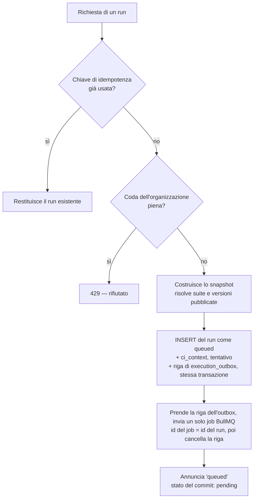
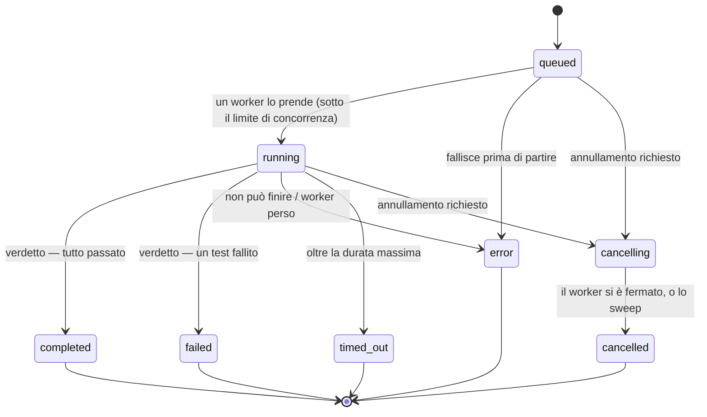

# Ciclo di vita di un run

Un **run** (una riga di `test_plan_executions`) è un'esecuzione di un piano di test. Questa pagina segue
un run dal momento in cui qualcuno lo chiede fino allo stato del commit che lo riporta, e spiega i
meccanismi che lo mantengono corretto quando i processi cadono, le richieste si ripetono e i worker
entrano in competizione.

## Chi chiede un run

I nuovi run fissano definizioni UI/API e versioni all’accodamento insieme a mobile, dataset e
impostazioni del piano. La pubblicazione viene risolta in quel momento: cambiarla durante l’attesa
non cambia il run. La review obbligatoria attuale può saltare una copia di lavoro congelata.

Ogni definizione UI viene congelata con il suo **bundle delle dipendenze**
(`server/authoring/executable-definition.ts`): i gruppi di step che chiama (in modo transitivo,
comprese le chiamate dei gruppi), gli elementi condivisi del repository e le custom action che
usano il test e i suoi gruppi, più gli id mancanti. Una versione pubblicata esegue il bundle
registrato con quella versione al salvataggio, cioè quello visto dalla review; una copia di lavoro,
o una versione salvata prima dei bundle, riceve il bundle catturato nella transazione di
accodamento. Il runner risolve un test congelato solo dal bundle e non legge mai `step_groups`,
`project_elements` o `custom_actions` per quel test. Il bundle conserva le definizioni come scritte:
i segnaposto `{{nome}}` restano segnaposto, quindi nessun valore segreto viene persistito.

Lo snapshot è privato del runner: lista/dettaglio run e risposte di avvio/annullamento lo omettono
e riportano provenienza sicura. SHA-256 copre JSON canonico (chiavi ordinate, array nell’ordine
originale) di impostazioni, definizioni e dataset. La relazione di replay è esclusa dall’impronta.
Il worker rifiuta nuovi snapshot incompleti o non corrispondenti. I test cancellati producono
risultati con ID originali nella provenienza e chiavi esterne nulle per i collegamenti mancanti.

`POST /api/test-plan-executions/:executionId/replay` accetta solo `{ "mode": "historical" }`.
Verifica visibilità/integrità del sorgente, copia la configurazione senza espandere il piano attuale,
controlla quote attuali e accoda un run manuale. `replayOf` identifica il sorgente; schedule e CI
non vengono ereditati. `Idempotency-Key` è circoscritta al sorgente. Input incompleti/vecchi: `409`;
sorgente non accessibile o piano assente: `404`. Il piano deve ancora esistere. Nessuna ricostruzione
dichiara completi i run precedenti, che conservano la risoluzione all’avvio.

Variabili/segreti, sessioni salvate, griglie, agenti, browser, profili BDD, quarantena, review,
integrazioni e applicazione sotto test restano correnti. Il replay riproduce la configurazione
conservata, non lo stato esterno né l’esito. HTML/PDF, allegati Allure e proprietà JUnit riportano
metadati e impronte sicuri, senza valori conservati.

| Origine                                      | Percorso                                                                                                     | `triggered_by`          |
| -------------------------------------------- | ------------------------------------------------------------------------------------------------------------ | ----------------------- |
| Pulsante Run nell'applicazione               | `POST /api/test-plans/:id/run`                                                                               | `manual`                |
| Schedulazione                                | `server/execution/scheduler-service.ts` (cron nel processo web, o job scheduler BullMQ avviati da un worker) | `scheduled`             |
| Pipeline                                     | `POST /api/v1/plans/:planId/runs` (la usa la CLI)                                                            | `api`                   |
| Webhook CI                                   | `POST /api/webhooks/execute` con un token di webhook                                                         | `webhook`               |
| Nuovo tentativo di un run schedulato fallito | il worker, tramite l'orchestrator                                                                            | come il primo tentativo |

Passano tutti da un'unica funzione: l'**orchestrator** (`server/execution/execution-orchestrator.ts`).

## 1. Creazione: l'orchestrator

1. **Idempotenza.** Chi chiama può inviare una chiave di idempotenza; chiedere due volte con la stessa
   chiave restituisce il primo run. Un indice univoco per organizzazione risolve due richieste che
   arrivano nello stesso istante.
2. **Limite di coda.** Oltre `max_queued_runs` dell'organizzazione la richiesta è rifiutata con `429`
   invece di riempire la coda per tutti ([limiti](./tenancy#limiti-per-organizzazione)).
3. **Snapshot.** Tutto ciò che il runner leggerà viene scritto in `configuration_snapshot`
   (`server/execution/execution-snapshot.ts`): la configurazione dei browser, i test selezionati (con le suite già
   espanse in test), i test visivi, la cattura delle evidenze, il parallelismo, i timeout, le policy di
   fallimento, la policy di riesecuzione, le notifiche, l'apertura di issue e il pool di agenti. Un piano
   modificato mentre il run aspetta non può cambiare ciò che il run fa. Un test aggiunto al piano dopo non
   fa parte di questo run.
4. **Un solo job.** Viene inviato esattamente un job BullMQ, con id uguale a quello del run: BullMQ
   rifiuta un secondo job con lo stesso id, quindi anche un duplicato sfuggito alla chiave non può girare
   due volte. Se Redis rifiuta l'invio, il run termina come `error` con `queue_submission_failed` e può
   essere recuperato chiedendolo di nuovo.
   Il job viene prima registrato in `execution_outbox`, nella stessa transazione che inserisce il run
   (`server/execution/execution-outbox.ts`): una transactional outbox. La richiesta prende poi la riga
   con un lease (`EXECUTION_OUTBOX_LEASE_MS`, default 60 s), invia il job e cancella la riga. Un processo
   che si ferma dopo il commit lascia la riga; il dispatcher dell'outbox nel processo web (ogni 5 s)
   pubblica le righe con il lease scaduto e più vecchie di 15 s di tolleranza, con lo stesso id di job.
   Una richiesta ripetuta con la stessa chiave pubblica subito una riga in sospeso. Una riga che la coda
   continua a rifiutare viene ritentata con backoff e, dopo 10 tentativi, il run termina come `error`
   con `queue_submission_failed`.
5. **Priorità.** La priorità del job è equa fra organizzazioni: quella con meno run in corso passa avanti
   a quella che ne ha accodati cinquanta.

## 2. La macchina a stati

Lo `status` di un run si muove solo attraverso `server/execution/execution-state.ts`. Ogni passaggio è un unico
`UPDATE … WHERE status IN (stati da cui può arrivare)` condizionale: quando due processi competono, il
database ne lascia passare esattamente uno, e da uno stato finale non si esce.

I timestamp appartengono al passaggio, non a chi lo chiama: `running` imposta `started_at` e il primo
heartbeat, uno stato finale imposta `completed_at`, `cancelling` imposta `cancel_requested_at`.
L'annullamento di un run ancora `queued` lo chiude subito (`queued → cancelling → cancelled` in una sola
chiamata), perché nessun worker lo tiene.

Dopo ogni passaggio registrato, la macchina a stati **annuncia** la nuova riga ai listener registrati
nel processo (`onExecutionTransition`); il modulo dello stato dei commit è uno di questi.

## 3. Il worker prende il run

`server/worker.ts` consuma la coda dei piani con `WORKER_CONCURRENCY` job alla volta e chiama
`processTestPlanJob` (`server/execution/test-execution-service.ts`):

1. **Presa.** `takeExecution` conta, sotto lock, i run in esecuzione dell'organizzazione e porta il run a
   `running` solo se è sotto `max_concurrent_runs`. Altrimenti il job è ritardato di `RUN_DEFERRAL_MS`
   (10 s), segnato come rimandato per il limite, e il run resta `queued` — aspetta, non fallisce. Quando
   un run dell'organizzazione finisce, `server/execution/run-promotion.ts` promuove i job ritardati dei suoi run in
   attesa più vecchi, fino ai posti liberi, così vengono presi subito; il ritardo resta come riserva. Un
   run non più `queued` (già preso, annullato)
   non viene preso, ed è questo che fa girare una sola volta un job consegnato due volte.
2. **Sorveglianza.** `watchRun` (`server/execution/run-watch.ts`) avvia un heartbeat ogni
   `RUN_HEARTBEAT_INTERVAL_MS` (15 s). Ogni battito dice anche al worker se qualcuno ha chiesto di
   annullare e se il run è terminato altrove. Prima di scriverlo, il worker confronta il proprio
   orologio con `RUN_MAX_DURATION_MS` (3 h), così un database che fallisce o non risponde non può
   tenere in vita un run oltre il suo limite. I test lo ricevono tramite un `AbortSignal`, che interrompe
   lo step in corso e chiude la sessione browser del test stesso (vedi [Fermare un test](#stopping-a-test)).
3. **Lettura dello snapshot.** I run di prima degli snapshot (`{}`) ripiegano sul piano com'è ora. Uno
   snapshot **corrotto** (illeggibile, o di versione nota ma incompleto), di versione **non
   supportata**, con definizioni in un formato sconosciuto o il cui bundle delle dipendenze non
   corrisponde più alla sua impronta viene rifiutato: il run termina in `error` con
   `corrupt_snapshot`, `unsupported_snapshot` o `unusable_snapshot`, e non viene mai eseguito dal
   piano attuale al suo posto.

   | Dato (R1)                                    | Formati letti | Altro                     |
   | -------------------------------------------- | ------------- | ------------------------- |
   | `configuration_snapshot.version`             | `1`, `{}`     | rifiutato                 |
   | `configuration_snapshot.definitions.version` | `1`, `2`      | rifiutato                 |
   | `protocol` del bundle (run, versione)        | `1`           | il test fallisce per nome |

   `definitions.version` 1 non ha bundle (run accodati prima di R1, che leggono gruppi, elementi e
   custom action dal vivo); 2 ne porta uno per ogni definizione UI. Un worker precedente a R1
   rifiuta un run in formato 2 invece di eseguirlo con dipendenze correnti; dopo la prima scrittura
   in formato 2 non si torna sotto R1 (`shared/execution-provenance.ts`,
   `SUPPORTED_EXECUTION_PROTOCOLS`).

4. **Risoluzione delle variabili**, una volta per run: i default dell'installazione, i valori
   dell'ambiente e i suoi segreti decifrati (`server/runtime/variables.ts`). La stessa risoluzione alimenta
   precondizioni, step UI e richieste API.

### Le fasi di un run

`processTestPlanJob` stabilisce solo il contesto del tenant; il run vero e proprio è `runPlanJob`
(`server/execution/plan-run/pipeline.ts`), che chiama una fase dopo l'altra. Ogni fase è una funzione di un suo
modulo che riceve ciò che legge e restituisce ciò che produce, così si legge e si testa da sola:

| Fase                    | Modulo                                    | Produce                                                                                         |
| ----------------------- | ----------------------------------------- | ----------------------------------------------------------------------------------------------- |
| Directory dei risultati | `plan-run/inputs.ts`                      | `./results/<piano>/<run>`, oppure il run termina in errore                                      |
| Input                   | `plan-run/inputs.ts`                      | la riga dell'esecuzione e il suo snapshot                                                       |
| Browser                 | `plan-run/browsers.ts`                    | i passaggi, su una grid o un pool di agent                                                      |
| Impostazioni            | `plan-run/settings.ts`                    | evidenze, policy, visual testing                                                                |
| Variabili               | `plan-run/inputs.ts`                      | segreti e variabili dei dati, per passaggio                                                     |
| Definizioni             | `plan-run/definitions.ts`                 | i test e le versioni che girano, policy di revisione, dataset                                   |
| Quarantena              | `plan-run/definitions.ts`                 | i test i cui fallimenti non fanno fallire il run                                                |
| Prova dei browser       | `plan-run/browsers.ts`                    | i passaggi che questo runner riesce ad avviare                                                  |
| Corsie e manifest       | `plan-run/lanes.ts`, `execution-units.ts` | una corsia per browser e lingua (pura); le unità dovute dal run, scritte prima che ne parta una |
| Esecuzione              | `plan-run/execute-lanes.ts`               | ogni unità tramite `plan-run/run-unit.ts`, in sequenza, in parallelo o condivisa                |
| Verdetto e dopo il run  | `plan-run/finalize.ts`, `after-run.ts`    | la chiusura, il retry, le issue, il test management, la notifica                                |

Una fase che chiude il run in anticipo (nessuna directory dei risultati, nessuna riga di esecuzione)
restituisce `Ended` e la pipeline si ferma lì. Un singolo test fuori da un piano è `runTest`
(`server/execution/run-test.ts`).

## 4. L'esecuzione del piano

### Passaggi per browser

`browsersForRun` (`server/runtime/browsers.ts`) trasforma ciò che il piano o la schedulazione indicano
("chrome", "edge", "safari", visibile o headless) in motori e canali Playwright, e dichiara ciò che non
può rispettare (un sistema operativo, una versione di browser, Safari vero e proprio). I browser della
schedulazione prevalgono sulle macchine del piano. Se non ne è configurato nessuno, il run usa il
browser predefinito dell'utente che lo ha richiesto.

Se il piano è impostato su un **pool di agenti**, ogni passaggio prende in prestito il browser dagli
agenti locali del pool invece di avviarne uno ([Agenti locali](./agents)), e anche le richieste API del
run partono dall'agente.

Ogni browser viene provato prima dei test; uno che non parte è riportato come guasto di
infrastruttura del run (che diventa `error`), non come test falliti. Un browser visibile che non può
partire su una macchina senza display ripiega su headless, e lo dice.

### Corsie e parallelismo

Ogni test gira una volta per ogni browser utilizzabile. Una **corsia** è il passaggio di un browser sul
piano, con la propria mappa di valori catturati. `max_parallel_tests` del piano (limitato da
`RUN_MAX_PARALLEL` dell'installazione) decide quanti test girano insieme:

- `1` — l'ordine storico: un browser alla volta, test in sequenza.
- `> 1` con test API **concatenati** (un'estrazione alimenta una richiesta successiva) — browser
  affiancati, test in ordine dentro ogni corsia.
- `> 1` negli altri casi — qualsiasi test di qualsiasi corsia, fino al limite.

### Il manifest: unità e tentativi

Prima che parta il primo test, il coordinatore scrive il **manifest** del run in `execution_units`
(`server/execution/execution-units.ts`, migrazione 0091): una riga per ogni **unità** di cui il run
deve un risultato. Un'unità è un test del piano su un browser e una lingua, un target di dispositivo
mobile, o una riga di un dataset BDD. Il suo id (`u_` + 24 caratteri esadecimali) è un hash dell'id
del run e delle coordinate dell'unità — il test, quale **occorrenza** nel piano (lo stesso test due
volte sono due unità), il browser richiesto (nome, canale, dispositivo emulato, macchina), la lingua,
il target del dispositivo e l'indice della riga BDD. Nient'altro: nessun valore di dataset, URL,
segreto o nome. Vale dentro il run; non è un'impronta per confrontare run diversi
(`shared/execution-identity.ts`).

Il manifest registra ciò che il piano ha **chiesto**, non ciò che è sopravvissuto alla prova dei
browser: un browser che non parte contribuisce le sue unità come `not_startable`, con il motivo della
prova, e un ripiego (da visibile a headless, da canale a motore) mantiene l'identità del browser
indicato dal piano. Le unità manuali, mobile e BDD, che girano una volta per run, compaiono una volta.
Riscrivere lo stesso manifest non cambia nulla; uno diverso viene rifiutato.

Ogni prova di un'unità è un **tentativo** in `execution_unit_attempts`: assegnato (1, 2, … per ogni
riesecuzione) e validato — l'unità deve stare nel manifest di questo run e dovere ancora il suo
risultato — prima che la prova apra un browser o scriva evidenze, poi chiuso con l'esito della prova.
La riga di risultato in `report_test_case_results` resta la proiezione del report e ora indica la sua
unità (`execution_unit_id`) e il tentativo che l'ha decisa (`unit_attempt`; nessuno per un'unità che
non è stata provata, come una saltata o manuale). Il database tiene **una sola riga finale per
unità**; una seconda viene rifiutata e conta come risultato non registrato. Ogni collegamento è della
stessa organizzazione per chiave esterna composta, ed entrambe le tabelle sono sotto RLS.

Le righe scritte prima del manifest non hanno unità e non ne ricevono: nulla viene ricostruito da
nomi o conteggi. `unitReport` legge entrambe in un unico modello — le unità del manifest con il loro
risultato (o nessuno), poi ogni riga senza unità come `legacy`. Ordine, valori catturati fra test API
concatenati, ambito delle riesecuzioni e righe dei dataset UI (che restano dentro il loro tentativo)
non cambiano.

**Attivazione.** La migrazione è additiva, e un worker precedente continua a scrivere righe senza
unità, che ogni lettore accetta; gli elementi di lavoro di un run condiviso portano l'id dell'unità, e
un aiutante che non lo conosce ignora il campo. Il manifest non decide ancora il verdetto: quel
passaggio (un'unità attesa senza risultato rende il run incompleto) arriva quando ogni worker scrive
unità — dopo che i vecchi worker sono stati aggiornati o svuotati.

### Shard: un run su più worker

`shards` del piano (1–8, nello snapshot) permette a più worker di dividersi un run
(`server/runtime/run-shards.ts`). Il worker che ha preso il run — il coordinatore — scrive il lavoro in
`run_work_items`: un elemento per unità, o uno per corsia quando le corsie sono concatenate. Ogni
elemento porta l'unità come l'ha risolta il coordinatore (browser, ripiego headless, motore, id dell'unità), così gli
aiutanti non sondano i browser. Poi accoda `shards − 1` job `execute-shard` (id `<run>-shard-<n>`).

Ogni partecipante esegue `maxParallelTests` cicli di presa. Una presa è `SELECT … FOR UPDATE SKIP
LOCKED` sul primo elemento `pending`, o su uno `claimed` il cui heartbeat è più vecchio di
`STALE_CLAIM_MS` (2 minuti); le prese hanno un heartbeat ogni `WORK_ITEM_HEARTBEAT_MS`. Solo chi tiene
un elemento può chiuderlo. Un aiutante esce quando non resta niente da prendere; il coordinatore aspetta
che ogni elemento sia chiuso, riprendendo quelli fermi, poi chiude il run come sempre. La vecchia lista
`results` e i test che non si sono potuti eseguire sono salvati su ogni elemento e uniti; l'arresto di
una regola del piano è scritto in `test_plan_executions.stop_reason` e letto prima di ogni presa. Un
aiutante si unisce solo a un run `running`, lo sorveglia come il coordinatore (annullamento, limite di
tempo dall'inizio del run) e non ne cambia mai lo stato. Con `shards = 1` nulla di questo entra in gioco.

### Un test

`runTest` gestisce un test su un browser:

- **Quale versione.** I piani eseguono la **versione pubblicata** di un test web, API o mobile quando esiste; se
  l'organizzazione richiede la revisione, un test non pubblicato viene saltato invece di essere eseguito
  senza revisione (`server/authoring/test-publishing.ts`).
- Le **precondizioni** (chiamate API che preparano lo stato) girano per prime; ciascuna può essere
  saltata quando un controllo mostra che lo stato esiste già. Cosa significhi una precondizione fallita
  lo decide la policy del piano: bloccare il test (`error`), saltarlo o proseguire comunque.
- Le chiamate di **pulizia** (`server/runtime/cleanup-runner.ts`) girano dopo il test qualunque sia l'esito,
  anche se bloccato da una precondizione, una volta per ogni esecuzione degli step (ogni riga del
  dataset) con le variabili con cui quella esecuzione è finita; ogni chiamata viene tentata, 404/410
  significano già rimosso, e una chiamata che nomina una variabile non impostata viene saltata. Sono
  l'ultima riga degli step del test (`type: cleanup`) e non ne cambiano mai lo stato.
- I **test UI** girano tramite `playwrightService.executeTestSequence`. Prima del primo step si espandono
  i gruppi di step (la chiamata a un gruppo diventa gli step del gruppo), le custom action diventano
  lo script che eseguono e si risolvono gli elementi del repository (uno step che nomina un elemento
  condiviso usa il selettore dell'elemento). In un run di piano tutti e tre vengono dal bundle
  congelato con la definizione; un run ad hoc dal builder li legge dal vivo. Una versione il cui
  bundle registrato è corrotto o in un formato sconosciuto fallisce con un messaggio esplicito e non
  viene mai eseguita come copia di lavoro. Un test con un **dataset** gira una volta per riga, e ogni
  riga aggiunge le proprie `{{variabili}}`.
- Ogni step passa da `server/web/step-executor.ts`, l'unica implementazione di ogni azione: `navigate`,
  `click`, `input`, `select`, `selectByText`, `hover`, `scroll`, `wait`, attese condizionali
  (`waitForElement`, `waitForText`, `waitForNetworkIdle`), asserzioni (`assert`, `assertTextContains`,
  `assertElementCount`, `assertState`, `assertAccessible`) ed `ensureState`. Le asserzioni aspettano
  fino a 5 s che la pagina si stabilizzi; le attese esplicite fino a 15 s.
- **Correzione automatica.** Quando un clic o un inserimento non trova il proprio elemento ed è
  configurata una chiave AI, il DOM della pagina e l'errore vanno al modello, che propone un selettore.
  Se il nuovo tentativo con quel selettore riesce, lo step è marcato _healed_ e il selettore è
  proposto alla sorgente dello step, presa dalla provenienza che ogni step preparato porta con sé
  (`server/authoring/step-provenance.ts`): l'elemento condiviso del repository, lo step del gruppo
  o lo step del test nella sua posizione scritta, mai la posizione del runner nella sequenza
  espansa. `server/authoring/selector-healing.ts` lo scrive in una transazione del tenant, dopo
  aver bloccato la riga e confrontato il fingerprint preso quando il run l'ha preparata, con
  versione (step del test) e voce di audit nella stessa transazione. Altrimenti segnala un conflitto
  nel `healing` dello step.
- **Evidenze.** Screenshot secondo la policy del piano; video, trace di Playwright e cattura di rete HAR
  secondo le impostazioni (`never`, `on_failure`, `always`); confronto visivo con le baseline per step
  quando i test visivi sono attivi (`server/web/visual-testing.ts` restituisce `match`, `diff`,
  `baseline-created`/`baseline-updated`, oppure `error` con una causa tipizzata; `visual-verdict.ts`
  rende un diff un test fallito e un errore un test in `error`, il cui step non conta come fallimento
  di step per la policy di stop; uno step che non cambia nulla a schermo non viene confrontato, per
  scelta); risultati di accessibilità per gli step `assertAccessible`; Web
  Vitals per `measurePerformance` e punteggi più il report HTML per `auditLighthouse`
  (`server/web/web-performance.ts`, Lighthouse eseguito come processo separato).
- I **test API** girano tramite `server/api-tests/api-test-runner.ts`: variabili sostituite, autenticazione
  applicata (Bearer, Basic, chiave API, OAuth 2.0 client credentials o password grant, e gli schemi
  di firma e di challenge di `server/identity/api-auth.ts`: JWT, OAuth 1.0, Hawk, AWS SigV4, Akamai EdgeGrid,
  ASAP, Digest e NTLM — gli ultimi due rispondono al 401 del server, NTLM su un'unica connessione),
  asserzioni valutate, valori estratti nella mappa della corsia per le richieste successive.

### Dopo ogni test

- La riga di risultato (`report_test_case_results`) viene scritta con stato, step, percorsi delle
  evidenze, browser, versione del test, la sua unità e il tentativo decisivo, e se il test è in
  **quarantena**.
- **Riesecuzione in caso di fallimento**: la policy del piano riesegue un test fallito, ogni volta come
  nuovo tentativo della stessa unità; conta l'ultimo
  tentativo, e il numero di tentativi viene registrato, così un test che ne ha richiesti due appare
  instabile.
- **Policy di fallimento**: uno step fallito può fermare il test o l'intero run, secondo il piano
  (`server/runtime/run-policies.ts`). Il fallimento di un test in quarantena non ferma mai un run.

## 5. Il verdetto

Quando tutte le corsie hanno finito, le evidenze rimaste nella cartella del run vengono pubblicate
nell'archivio degli artefatti e gli aggregati vengono calcolati dalle righe di risultato:

| Esito                                                            | Stato                         |
| ---------------------------------------------------------------- | ----------------------------- |
| Fermato da un annullamento                                       | `cancelled`                   |
| Oltre la durata massima                                          | `timed_out` (`run_timed_out`) |
| Almeno un fallimento non in quarantena                           | `failed`                      |
| Un browser che non è partito, o un test che non è stato eseguito | `error` (`run_incomplete`)    |
| Un test la cui riga di risultato non è stata scritta             | `error` (`run_incomplete`)    |
| Altrimenti                                                       | `completed`                   |

I fallimenti dei test in quarantena vengono contati (`quarantined_failures`) ma non decidono il run.

Un **test fallito** e un **risultato non registrabile** sono cose diverse. Un test fallito ha la
sua riga, con il fallimento dentro, e rende il run `failed`. Quando il database rifiuta una riga
(`saveReportEntry` in `server/execution/plan-run/report-entry.ts` lancia `ReportEntryNotSavedError`),
l'esito di quel test è ignoto al report: l'unità viene contata fra i fallimenti di unità del run,
la corsia prosegue con il test successivo, e il run non può chiudersi `completed` sulle righe che
sono state salvate. Il messaggio di errore nomina il test ("The result of "Login" could not be
recorded: …"); il log del server riporta il run, tipo, id, nome, browser e stato del test e il
motivo del database, mai gli step o le evidenze della riga. Un run che ha anche un fallimento
registrato resta `failed`.

Poi, per un run arrivato a un verdetto:

1. **Nuovo tentativo.** Un tentativo fallito con tentativi rimasti accoda il successivo dopo
   `RETRY_DELAY_MS` (30 s). I tentativi vengono dalla policy di retry di una schedulazione
   (`max_attempts`, al massimo 5); gli altri run ne hanno uno. Issue e notifiche aspettano il tentativo
   che decide.
2. **Issue.** Con un tracker configurato e l'apertura attiva, ogni nuovo fallimento apre una issue in
   Jira o Azure DevOps, e un fallimento già segnalato riceve invece un commento (`server/integrations/issue-store.ts`).
3. **Notifica.** Il webhook del piano (Slack, Teams o qualsiasi cosa accetti una POST) viene avvisato,
   secondo i suoi interruttori (`server/integrations/notifications.ts`).
4. **Stato del commit.** Per un run avviato da GitHub Actions o GitLab CI, il commit riceve lo stato
   finale con il link al report (`server/integrations/commit-status.ts`).

Nessuno di questi può cambiare il verdetto: ogni errore è registrato e riportato come esito.

## 6. Quando qualcosa va storto

| Situazione                                               | Cosa succede                                                                                                                                                                                                                                                                                                                                                                                                       |
| -------------------------------------------------------- | ------------------------------------------------------------------------------------------------------------------------------------------------------------------------------------------------------------------------------------------------------------------------------------------------------------------------------------------------------------------------------------------------------------------ |
| Qualcuno annulla                                         | `running → cancelling`; il worker lo sente al battito successivo, interrompe lo step in corso, chiude la sessione del test e chiude il run come `cancelled`.                                                                                                                                                                                                                                                       |
| Uno step si blocca                                       | Il timeout dello step; per ciò che non ne ha (uno script che non si risolve mai), la scadenza dello step `RUN_STEP_DEADLINE_MS`; poi la durata massima del run (`timed_out`).                                                                                                                                                                                                                                      |
| Il worker muore                                          | Il suo heartbeat si ferma. Lo sweep di recupero nel processo web (`server/execution/run-recovery.ts`) chiude i run silenziosi da `RUN_STALE_AFTER_MS` (default 2 min): `running → error` (`worker_lost`), `cancelling → cancelled`. Un run schedulato con tentativi rimasti riceve il tentativo successivo. Non viene rieseguito di nascosto: metà run potrebbe aver già creato dati nell'applicazione sotto test. |
| Il worker è vivo ma bloccato                             | Oltre la durata massima più 5 minuti di tolleranza, lo sweep lo chiude come `timed_out`.                                                                                                                                                                                                                                                                                                                           |
| Il processo web si ferma dopo aver creato un run         | Il job del run è ancora in `execution_outbox`. Scaduto il lease, il dispatcher dell'outbox di qualsiasi processo web lo pubblica con l'id del run come id del job; il run non resta mai `queued` senza job.                                                                                                                                                                                                        |
| BullMQ consegna un job due volte                         | Il secondo `takeExecution` trova il run non più `queued` e non fa nulla.                                                                                                                                                                                                                                                                                                                                           |
| Arriva una scrittura tardiva da un worker dato per perso | L'update condizionale non trova nulla; la chiusura registrata resta valida.                                                                                                                                                                                                                                                                                                                                        |

Più server web possono fare lo sweep contemporaneamente: ogni chiusura passa dalla macchina a stati,
quindi ogni run viene chiuso una sola volta.

### Fermare un test {#stopping-a-test}

Uno stop viene prima rilevato, poi eseguito; le due cose richiedono tempi diversi.

| Budget                   | Default | Cosa limita                                                                                                                                                                                                    |
| ------------------------ | ------- | -------------------------------------------------------------------------------------------------------------------------------------------------------------------------------------------------------------- |
| Polling                  | 15 s    | `RUN_HEARTBEAT_INTERVAL_MS`: quanto può attendere un annullamento prima che il worker lo veda. Il limite di durata del run usa l'orologio del worker e scatta allo stesso controllo.                           |
| Limite del run           | 3 h     | `RUN_MAX_DURATION_MS`: l'intero run (`timed_out`).                                                                                                                                                             |
| Scadenza dello step      | 5 min   | `RUN_STEP_DEADLINE_MS`: uno step, tutto — l'azione, il suo retry, lo screenshot, il controllo visivo. Più lunga se il test imposta `mailpit.timeout`, `sms.timeout` o `db.timeout` oltre (quel valore + 30 s). |
| Chiusura dopo il segnale | ≤ 5 s   | Dall'`AbortSignal` alla sessione chiusa e allo slot libero: `SESSION_CLOSE_STEP_MS` (2 s) per fase di chiusura, poi `STEP_SETTLE_MS` (3 s) perché il lavoro abbandonato termini.                               |

`runBounded` (`server/web/step-executor.ts`) esegue ogni step, l'avvio del browser, la prima
navigazione e il salvataggio delle evidenze. A uno stop non smette solo di aspettare: chiude la
sessione del test stesso, il che fa fallire le chiamate Playwright pendenti dello step, attende che
il lavoro abbandonato termini e solo allora riporta l'esito. Così un test non risponde mai mentre il
suo script è ancora in esecuzione, e il test successivo può occuparne subito lo slot.

- **Prima dell'avvio**: nessun browser viene aperto.
- **Durante l'avvio**: la sessione viene chiusa appena esiste; un avvio non si può revocare.
- **Durante uno step**: lo step risulta `Stopped: <motivo>` e lo step successivo non parte. Uno step
  abbandonato così non viene ritentato.
- **Fra due step**: lo step successivo risulta fermato senza essere avviato.
- **Durante il salvataggio delle evidenze**: la sessione viene chiusa e quelle evidenze vengono
  scartate. Un test già fermato ha `STEP_SETTLE_MS` per salvare ciò che ha.

Il risultato del test riporta `interrupted: cancelled | timed_out | lost`; la chiusura del run viene
dal watch, come sopra. Uno script bloccato in un ciclo sincrono termina allo stesso modo: un browser
locale è un processo avviato per quel solo test, e chiuderlo termina il ciclo.

**Target remoti.** Su una browser grid o su un agent il teardown riguarda solo questa sessione: il
suo contesto viene chiuso e la sua connessione interrotta. Lì non viene fermato nient'altro — né
l'agent, né il browser di un altro utente. Il provider può mantenere la sua parte della sessione fino
al proprio timeout di inattività, e uno script bloccato in una pagina remota si ferma quando il
provider chiude quella pagina.

## 7. Avanzamento in diretta

Mentre un run gira, il worker emette voci di log (messaggi di sistema, avanzamento degli step, console
del browser) tramite `server/http/websocket.ts`. Vengono salvate in `execution_logs` e inviate via WebSocket
alla pagina del report, che le mostra in diretta e le ripropone a run concluso.

## 8. Task browser

Non ogni sessione di browser è un run di un piano. L'anteprima di una sequenza, l'esecuzione di un
singolo test dal builder e la rilevazione degli elementi di una pagina sono **task browser**
(`server/web/browser-tasks.ts`): la rotta web mette il task nella sua coda BullMQ, un worker lo esegue e la
rotta risponde con il risultato — così una persona non aspetta dietro un run notturno di quaranta
minuti, e il processo web non tiene mai un browser. `BROWSER_TASKS=inline` li esegue invece nel processo
web (test, sviluppo su una sola macchina).

La **registrazione** fa eccezione: apre una finestra di browser visibile tramite Playwright sulla
macchina che esegue il processo web, quindi funziona solo dove quella macchina ha un display.

## 9. Schedulazioni

Una schedulazione (`test_plan_schedules`) indica un piano, una frequenza (o un'espressione cron) e un
fuso orario, i browser, un ambiente, una sovrascrittura delle notifiche e una policy di retry. Ogni
occorrenza ha una chiave di idempotenza stabile (`occurrenceKey`), quindi due repliche dello scheduler
che scattano nello stesso minuto producono un solo run. Il backend predefinito, `bullmq`, usa i job
scheduler di Redis, che sopravvivono ai riavvii e non si duplicano fra istanze; il trigger lo gestisce
un worker. `SCHEDULER_BACKEND=cron` le avvia invece da node-cron nel processo web, una volta per
processo web: per un unico processo senza worker.

## Evidenza delle matrici reali

I test UI salvati conservano browser/OS/versioni richiesti e osservati per ogni passaggio, incluse le righe dataset. I piani mobile conservano dispositivo/OS restituiti dalle capabilities W3C di Appium. Report UI, HTML/PDF, allegati Allure e proprietà JUnit `wfm.matrix` espongono questi dati. Sono conservati soltanto i campi di piattaforma previsti.

La corrispondenza (`matched`, `mismatch`, `unverified`) è indipendente dall'esito funzionale. Le versioni OS locali sono release del kernel; l'OS remoto non viene dedotto dal worker o dal user-agent. Emulazione browser e sostituzione WebKit non certificano dispositivi reali o Safari. Gli esiti storici senza evidenza rimangono non certificati.

La suite UI dell'installazione esegue Chromium, Firefox e WebKit. `npm run test:matrix:certify` richiede `WFM_MATRIX_CERTIFICATION_FILE` con target griglia web e Appium reali e fallisce quando manca infrastruttura o evidenza corrispondente. Procedura nel repository: `collaudo/real-matrix-certification.md`; servono credenziali cloud, fixture raggiungibili, app/driver installati e dispositivi connessi. Appium locale è raggiunto tramite un agente effimero del tenant.
