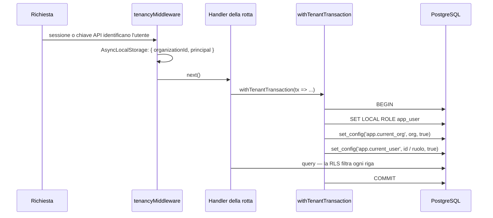

# Tenancy e accessi

Molte organizzazioni condividono un'installazione. Questa pagina spiega come vengono tenuti separati
i loro dati, chi può fare cosa dentro un'organizzazione, e come si autenticano persone e macchine.

## Organizzazioni e membri

Un'**organizzazione** possiede tutto ciò che un team crea: progetti, test, piani, run, ambienti,
credenziali. Ogni tabella per organizzazione ha un `organization_id`, e ogni utente agisce in una
sola organizzazione alla volta — la sua organizzazione **corrente** — con un solo **ruolo** lì:

| Ruolo    | Può                                                                                                                                                                      |
| -------- | ------------------------------------------------------------------------------------------------------------------------------------------------------------------------ |
| `viewer` | Leggere tutto ciò che l'organizzazione vede; non esegue nulla e non modifica nulla.                                                                                      |
| `editor` | Creare e modificare test, piani, schedulazioni, suite, ambienti; avviare e annullare run.                                                                                |
| `owner`  | Tutto ciò che può un editor, più membri e inviti, chiavi API altrui, service account, agenti locali, collegamenti GitHub/GitLab, policy di sicurezza, runner, audit log. |

I ruoli sono controllati da `requireRole(minimo)` (`server/http/middleware/require-role.ts`) su ogni rotta.
Decidono quali **operazioni** un utente può fare. Quali **righe** esistono per lui lo decide il
database.

### Appartenenze e organizzazione corrente

Una persona può appartenere a più organizzazioni (migrazione 0086). Lo reggono due cose:

- `organization_memberships` (`user_id`, `organization_id`, `role`) è l'insieme delle organizzazioni
  in cui l'account può agire, con il ruolo che ha in ciascuna. È una tabella per organizzazione
  protetta da RLS come tutte le altre: dentro un'organizzazione si vedono i suoi membri e nient'altro.
- L'organizzazione in cui agisce una richiesta appartiene alla **richiesta**, non all'account. La
  sessione la salva accanto all'id utente e all'impronta della password (`{ id, pw, org }`,
  `serializeUser` in `server/identity/auth.ts`); una chiave API agisce nell'organizzazione che l'ha
  emessa (`server/http/middleware/api-key-auth.ts`). In entrambi i casi `actingAs`
  (`server/tenancy/organization-memberships.ts`) rilegge l'appartenenza a ogni richiesta e mette su
  `req.user` la sua organizzazione e il suo ruolo; senza appartenenza non c'è utente: la sessione
  termina, la chiave è rifiutata. `tenancyMiddleware`, il binding `app.current_org` di ogni policy e
  `requireRole` leggono `req.user` come prima. Due browser della stessa persona possono così agire
  in due organizzazioni: il cambio in uno non sposta l'altro, il cui prossimo progetto finisce dove
  mostra.
- `users.organization_id` e `users.role` indicano solo l'ultima organizzazione scelta dall'account e
  il ruolo lì: da dove parte un nuovo accesso (password o single sign-on). Il cambio
  (`POST /api/organizations/switch`) copia l'appartenenza scelta sulla riga, ristabilisce la sessione
  che l'ha chiesto (`req.login`) e registra `organization.switched` nell'organizzazione in cui si
  entra. Una sessione nata prima che l'organizzazione vi fosse salvata agisce in quella della riga.

Nessun controllo di appartenenza passa più dalla riga dell'utente: se qualcuno è membro di
un'organizzazione (chi ha chiesto un run, un posto in un progetto, una menzione, il reset del
secondo fattore di un membro da parte di un owner) è un join su `organization_memberships`. I
vincoli a due colonne `…_same_org_fk` sulle righe di una persona (chiavi, posti nei progetti, link di
reset, dashboard, sessioni del provider, righe SCIM, richiedente di un run, autore e risolutore di
un commento) puntano dalla migrazione 0089 a `organization_memberships(user_id, organization_id)`,
non a `users(id, organization_id)`: puntando alla riga, rifiutavano ciò che una sessione creava
fuori dall'organizzazione della riga, e il cambio stesso per chi aveva una chiave o un run. Rimuovere
un'appartenenza cancella le righe proprie della persona lì e la dimentica come richiedente o
autrice.

L'appartenenza dell'organizzazione corrente è tenuta allineata da un trigger su `users`
(`users_sync_current_membership`): creare un account, o cambiare `users.role`, fa l'upsert della
riga di appartenenza corrispondente. Così ogni percorso nato prima della tabella — registrazione,
inviti, single sign-on, SCIM, il menu dei ruoli degli owner — mantiene corretta l'appartenenza senza
conoscerla. Cambiare il ruolo che qualcuno ha in un'organizzazione in cui non sta agendo tocca solo
l'appartenenza (`setMemberRole`).

A cos'altro appartiene una persona è l'unica domanda a cui un'organizzazione non può rispondere sui
propri membri: le altre appartenenze sono righe di altre organizzazioni. Elencarle per il selettore,
cambiare, spostare chi è stato appena rimosso dalla sua organizzazione corrente e ammettere un
account in un'organizzazione in più sono letture e scritture privilegiate della stessa forma di una
lettura di sessione, con un budget in `server/tests/architecture.test.ts`.

I nuovi membri entrano per **invito** (tabella `invitations`): un owner invita uno username con un
ruolo. Uno username che non esiste ancora si registra con il token e l'account viene creato dentro
l'organizzazione che ha invitato — un'operazione privilegiata, perché l'utente non esiste ancora
(`server/identity/storage.ts`). Uno username che esiste accede e accetta il link
(`POST /api/invitations/accept`), che aggiunge un'appartenenza e rende corrente la nuova
organizzazione. Senza invito si registra solo il primo account dell'installazione, a meno che
`REGISTRATION=open` (`server/identity/registration.ts`); il controllo "è il primo?" e la creazione
condividono un advisory lock. Il single sign-on ammette allo stesso modo un account di un'altra
organizzazione, ma solo su un dominio che l'organizzazione ha **verificato**
(`sso_domains.verified_at`), qualunque cosa dica `SSO_REQUIRE_DOMAIN_VERIFICATION`: la prova del
dominio è la prova della casella di posta, la stessa fiducia su cui già poggia la mail di reset
della password. SCIM gestisce solo l'appartenenza dell'organizzazione che provisiona, per gli
account che agiscono in essa.

Rimuovere un membro toglie l'organizzazione all'account: la sua appartenenza, le chiavi, i posti nei
progetti e le altre righe personali di quell'organizzazione se ne vanno, e se era la sua
organizzazione corrente passa a un'altra a cui appartiene. L'account viene cancellato solo se era la
sua ultima organizzazione. In entrambi i casi ciò che ha creato resta: `server/tenancy/member-removal.ts`
passa prima progetti, test, piani, schedulazioni, gruppi di step, ambienti e segreti a un altro
membro, e i vincoli su quelle tabelle sono `NO ACTION`, così una tabella dimenticata fa fallire la
rimozione invece di perdere righe. Un test controlla ogni vincolo che punta a `users`.
Un'organizzazione deve conservare almeno un owner, contato per appartenenza.

## Row-level security: è il database a separare le organizzazioni

L'isolamento è imposto dalla **row-level security (RLS)** di PostgreSQL, non da clausole `WHERE`
nell'applicazione. Ogni tabella per organizzazione ha:

```sql
ALTER TABLE "x" ENABLE ROW LEVEL SECURITY;
ALTER TABLE "x" FORCE ROW LEVEL SECURITY;
CREATE POLICY org_isolation ON "x"
  USING (NULLIF(current_setting('app.current_org', true), '')::int = organization_id)
  WITH CHECK (NULLIF(current_setting('app.current_org', true), '')::int = organization_id);
GRANT SELECT, INSERT, UPDATE[, DELETE] ON TABLE "x" TO app_user;
```

L'elenco di queste tabelle è `ORG_SCOPED_TABLES` in `shared/schema/tenancy.ts`, e un test di isolamento
(`server/tests/isolation.test.ts`, eseguito con `npm run test:rls`) dimostra per ognuna che le righe di
un'altra organizzazione sono invisibili e non scrivibili.

### Come una richiesta viene legata alla sua organizzazione



Tre dettagli reggono l'intero progetto (`server/platform/middleware/tenancy.ts`):

- **`SET LOCAL ROLE app_user`**: la RLS non ha effetto su un superuser o su un ruolo con `BYPASSRLS`.
  Il ruolo della connessione possiede le tabelle e può aggirare la RLS; `app_user` no. Ogni query di un
  tenant gira come `app_user`.
- **`LOCAL`**: la connessione viene da un pool. Un'impostazione non locale sopravvivrebbe alla
  transazione e porterebbe l'organizzazione nella richiesta successiva su quella connessione.
- **Parametri legati** per `set_config`: un valore ostile viene rifiutato dal cast a intero nella
  policy invece di essere eseguito.

Le chiamate annidate si uniscono alla transazione aperta invece di aprirne una seconda, e legare
un'organizzazione diversa dentro una transazione aperta genera `TenantConflictError`.

All'avvio, `assertTenancyPreconditions` (`server/platform/db.ts`) verifica che `app_user` esista, che il ruolo
della connessione possa passare a esso e che `app_user` non possa aggirare la RLS; altrimenti il server
non parte.

### Lavoro in background

Il lavoro che non è una richiesta — il worker che esegue un piano, un run schedulato, uno sweep — lega
l'organizzazione esplicitamente con `runWithTenant(orgId, fn)` o `runAsOrganization(orgId, fn)`. Senza
un principal legato, la transazione è "il sistema" e vede tutto ciò che la RLS della sua
organizzazione permette. `runDetachedForOrganization` apre un contesto nuovo per il lavoro che non deve
unirsi alla transazione del chiamante (per esempio l'avviso di stato del commit).

### L'handle privilegiato

`privilegedDb` si connette senza il cambio di ruolo e quindi aggira la RLS. Esiste per le tabelle
dell'installazione (`runners`, `system_settings`, `sessions`), per il bootstrap (registrazione, login,
verifica di chiavi API e token degli agenti, quando l'organizzazione non è ancora nota) e per
l'esportazione e la cancellazione di un'organizzazione (`server/tenancy/organization-lifecycle.ts`). Ogni file
autorizzato a usarlo, e quante volte, è elencato in `PRIVILEGED_BOOTSTRAP_BUDGET` in
`server/tests/architecture.test.ts`; un nuovo uso fa fallire la build finché qualcuno non ne scrive il
motivo.

### Collegamenti fra righe della stessa organizzazione

Una foreign key da una riga dell'organizzazione A a una dell'organizzazione B sarebbe una fuga di dati
attraverso un join. Un test di deriva in `server/authoring/test-suites.test.ts` elenca ogni foreign key fra
tabelle per organizzazione e richiede che ognuna sia protetta da un vincolo di stessa organizzazione o
dichiarata come collegamento di paternità (`created_by` e simili, che puntano agli utenti).

## Progetti riservati

Un **progetto** è aperto per default: sui suoi test vale il ruolo nell'organizzazione. Un progetto può
essere **riservato** (migrazione 0031): allora è visibile solo agli owner dell'organizzazione e ai suoi
`project_members`, e il ruolo di progetto di ciascun membro (`viewer` o `editor`) può restringere il
ruolo nell'organizzazione ma mai ampliarlo.

Anche questo è imposto dalla RLS: policy restrittive leggono `app.current_user` e
`app.current_user_role`, che `withTenantTransaction` imposta per una richiesta. Test, test API, gruppi
di step, elementi e suite di un progetto riservato sono invisibili ai non membri. Piani, run e report
restano a livello di organizzazione: un piano può eseguire i test di un progetto riservato.

`effectiveProjectRole` (`server/http/routes/projects.routes.ts`) calcola la stessa risposta per
l'interfaccia, così non propone una modifica che il database rifiuterebbe.

## Autenticazione

### Persone

- **Password**: strategia locale di Passport; le password sono cifrate con scrypt e un salt per utente.
- **Sessione**: `express-session`, salvata in Redis in produzione (senza, il server rifiuta di partire
  in produzione) e in memoria in sviluppo. Il cookie è `Secure` in produzione e non altrove;
  `SESSION_COOKIE_SECURE=true|false` lo forza (lo stack docker-compose fornito serve HTTP semplice su
  localhost e lo imposta a `false`).
- **Secondo fattore**: TOTP (RFC 6238) da un'app di autenticazione, più codici di recupero monouso
  (`server/identity/mfa.ts`). Una password accettata con un secondo fattore ancora dovuto non è un login. Un owner
  può rendere obbligatoria la MFA per l'organizzazione; `requireMfaEnrollment` lascia allora a un membro
  che non l'ha configurata solo la possibilità di configurarla, a ogni richiesta, così la policy vale
  anche per le sessioni già aperte.
- **CSRF**: una richiesta che modifica dati e porta un `Origin` o un `Referer` deve indicare l'host
  dell'applicazione (`server/http/middleware/csrf.ts`); le richieste senza nessuno dei due sono da server a
  server (CLI, webhook) e si autenticano con una chiave o un token. Un front end su un'altra origine si
  autorizza esplicitamente con `CSRF_TRUSTED_ORIGINS`.

### Macchine

| Credenziale                   | Per                                                      | Salvata come                   | Dettagli                                                                                                                                                                                                                                     |
| ----------------------------- | -------------------------------------------------------- | ------------------------------ | -------------------------------------------------------------------------------------------------------------------------------------------------------------------------------------------------------------------------------------------- |
| **Chiave API** (`wfm_…`)      | Pipeline e script                                        | Hash SHA-256 + prefisso        | Agisce come il suo utente o service account. Gli **scope** opzionali la limitano a `/api/v1` e a permessi precisi (`plans:read`, `runs:read`, `runs:write`); il ruolo del titolare vale comunque. Scadenza opzionale; ultimo uso registrato. |
| **Service account**           | Chiavi che devono sopravvivere a una persona             | Un utente che non può accedere | Ha un ruolo (mai `owner`) e possiede chiavi; disattivarlo le revoca tutte.                                                                                                                                                                   |
| **Token di webhook**          | Sistemi di CI che avviano un piano con un URL            | Hash SHA-256 + prefisso        | Inviato in `X-Webhook-Token` o `Authorization: Bearer`; mascherato nei log.                                                                                                                                                                  |
| **Token di agente** (`wfa_…`) | Agenti locali                                            | Hash SHA-256 + prefisso        | Identifica un agente di un'organizzazione; revocarlo lo disconnette.                                                                                                                                                                         |
| **Ticket del relay**          | Un runner che prende in prestito un browser di un agente | Non salvato                    | Firmato HMAC, indica organizzazione, pool e browser, valido 60 secondi.                                                                                                                                                                      |

Un token ad alta entropia non ha bisogno di essere "stirato": un solo SHA-256 rende la verifica una
query su indice e non lascia nulla da indovinare. Ognuno viene mostrato una sola volta, alla creazione.

## Segreti che il prodotto custodisce per i clienti

I segreti degli ambienti (variabili `{{secret_…}}`), i token degli issue tracker, i token GitHub/GitLab e
gli stati di login salvati (i cookie dell'applicazione sotto test) sono cifrati con **AES-256-GCM**
usando la `ENCRYPTION_KEY` dell'installazione (`server/platform/crypto.ts`), ognuno con il proprio IV e tag di
autenticazione. L'API non ne restituisce mai nessuno; un modulo di modifica che non può mostrare il
valore attuale tratta un campo vuoto come "lascia invariato". I log passano da un redactor
(`server/platform/utils/log-redactor.ts`) che maschera password, token e chiavi, e le catture HAR vengono ripulite
prima di essere salvate.

## Audit trail

`audit_log` registra chi ha fatto cosa: l'autore (utente, chiave API o sistema), l'azione
(`AUDIT_ACTIONS` in `shared/schema/identity.ts`), il bersaglio, i campi modificati e la provenienza della
richiesta: la chiave API con cui si è autenticata (null per una sessione) e l'indirizzo IP del client
(dietro un proxy, quello indicato dal proxy). `app_user` ha solo `SELECT` e `INSERT`: l'applicazione non
può riscrivere la propria storia. Le voci si scrivono nella stessa transazione della modifica che
descrivono (`recordAudit(tx, …)`), quindi modifica e registrazione vengono confermate o annullate
insieme. Gli owner le leggono in Settings.

## Limiti per organizzazione

`server/tenancy/tenant-quotas.ts` impedisce a un'organizzazione di affamare le altre: un massimo di run in
esecuzione contemporanea (un worker rimette in coda il run oltre il limite — aspetta, non fallisce), un
massimo di run in attesa (una richiesta oltre il limite riceve `429`) e un posto equo in coda per
l'organizzazione con meno run in corso. I limiti li imposta l'operatore sulla riga di `organizations`;
il ruolo applicativo non ha i permessi per cambiarli. Gli amministratori umani dell'installazione
usano `server/tenancy/tenant-quota-admin.ts`, servizio privilegiato con revisione e audit. Le modalità
off/monitor/enforce rendono le quote indipendenti dai pagamenti. Aggregati dell'intera organizzazione
usano funzioni SQL security-definer con controllo del tenant: i filtri dei progetti non riducono il
consumo. I test sono limitati all'inserimento, gli artefatti tramite prenotazioni/riconciliazione e
i minuti tramite budget di ammissione. Vedere [semantica delle quote](../admin/administration#quotas).

## Esportazione e cancellazione

`server/tenancy/organization-lifecycle.ts` esporta i dati di un'organizzazione e la cancella completamente,
comprese le righe che l'applicazione stessa non può eliminare (l'audit log). È l'unico modulo di dominio
privilegiato per progetto, perché cancellare un'organizzazione è un atto sul confine della tenancy, non
al suo interno.
